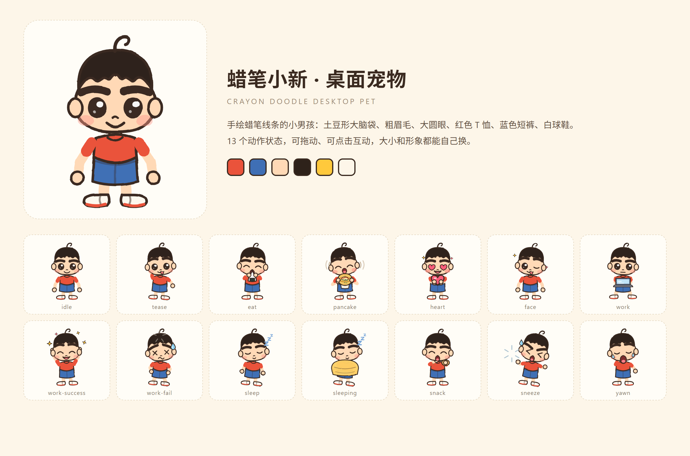
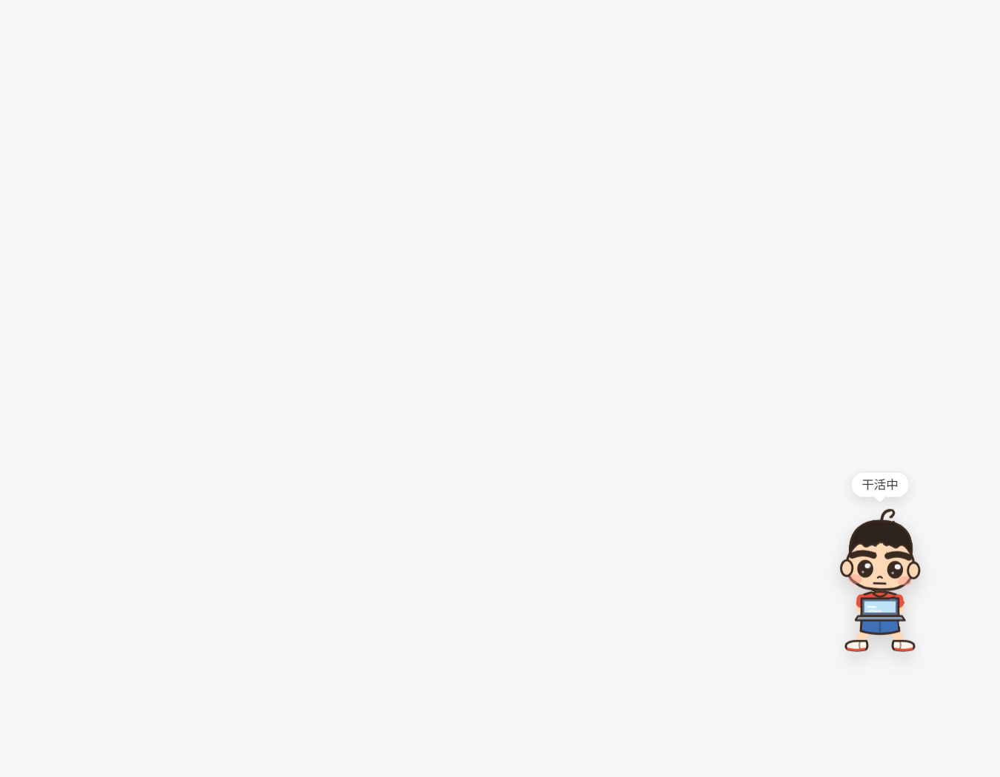
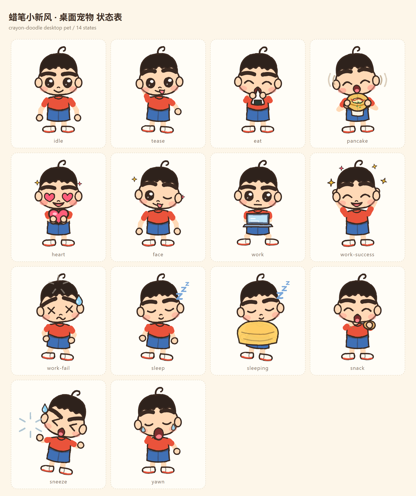
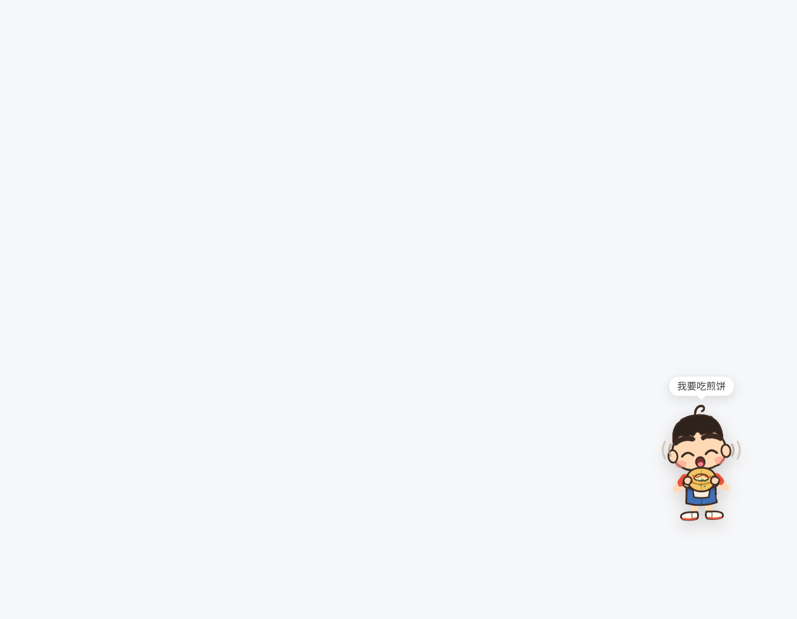
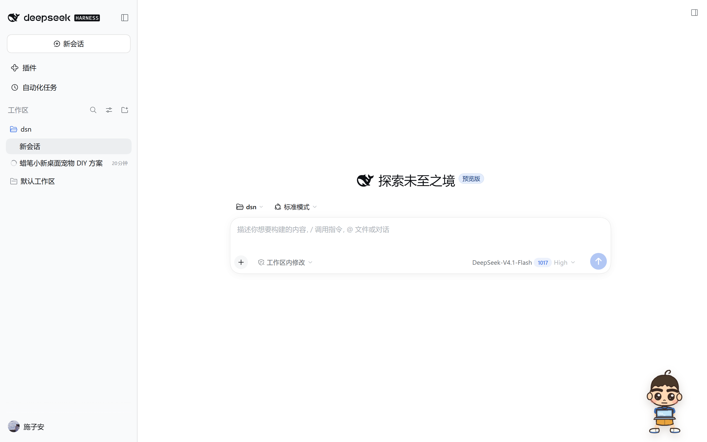

# dsh-crayon-pet

A crayon-doodle desktop pet that lives in the corner of the DSH Web GUI.
Draggable, pokes back, follows the agent's work state, and takes your own skins.



## Install

```powershell
# from GitHub (pin a tag to be safe)
dsh plugin --profile web add github:swh5160/dsh-crayon-pet#v1.2.0

# or from npm
dsh plugin --profile web add dsh-crayon-pet
```

Then restart `dsh web`. The pet appears in the bottom-right corner.

You can also paste `https://github.com/swh5160/dsh-crayon-pet` into
**插件 → 添加插件** in the Web GUI.

Uninstall:

```powershell
dsh plugin --profile web remove dsh-crayon-pet
```

## Use it

| Action | Result |
| --- | --- |
| left click | random reaction (tease / heart / silly face / sneeze); wakes it up if asleep; afterwards it returns to whatever it was doing — poking it while the agent works sends it back to `work`, not `idle` |
| drag | move it; the position is remembered |
| right click | menu: pose, size, skin, stroll, hide |
| 溜达一下 / stroll | send it for a walk right now |
| double click | blow a heart |
| after hiding | a small translucent dot stays in the corner; click it to bring the pet back |

A small speech bubble above its head names the current state (干活中 / 干完啦 / 困了 /
溜达中 …), so the pet doubles as a status indicator.



Automatic behaviour:

- any session running → `work` (typing on a laptop)
- run finishes → `work-success` with sparkles for 3.6 s, then `idle`
- idle for 2.5 min → `sleep`, 4 min → `sleeping`
- roughly every 20 s it does something on its own (yawn, snack, tease)
- while idle it wanders across the screen every so often: it walks to a random
  spot with a bobbing stride and turns to face the direction it moves in
- idle has a breathing bob and blinks every 3.6 s

## States

`idle, tease, eat, pancake, heart, face, work, work-success, work-fail, sleep, sleeping, snack, sneeze, yawn`

`pancake` is the kid holding a folded jianbing in both hands, shouting for it —
the bubble reads 我要吃煎饼. Pick it from the menu, or wait for the pet to crave
one on its own.





## Skins

Two sources are merged; the menu lists both.

1. **Bundled** — `pets/<id>/` inside this package.
   Ships with `blue-kid` (蓝衫男孩), a palette variant of the built-in art.
2. **Your own** — `%DSH_HOME%/pets/<id>/` (e.g. `C:\Users\<you>\.dsh\pets\<id>\`).
   A skin here with the same id overrides the bundled one.

```
%DSH_HOME%/pets/my-pet/
  pet.json
  idle.svg  tease.svg  eat.svg  heart.svg  face.svg  work.svg
  work-success.svg  work-fail.svg  sleep.svg  sleeping.svg
  snack.svg  sneeze.svg  yawn.svg
```

```json
{
  "name": "我的小猫",
  "scale": 1,
  "frames": {
    "idle": "idle.svg",
    "tease": "tease.svg"
  }
}
```

- Missing states fall back to `idle`.
- One image for everything: `{ "name": "Cat", "image": "cat.png" }`.
- Frames may be `.svg`, `.png`, `.jpg`, `.webp` or `.gif`; transparent, roughly 200×220.
- The folder name is the skin id. Reopen the menu after adding one.



## Development

The art is code: `art/character.mjs` builds every pose from parameters
(arm angles, eye shape, mouth shape, props). Then:

```powershell
node art/preview.mjs sheet          # state sheet  -> art/out/sheet.png
node art/preview.mjs poster         # poster       -> art/out/poster.png
node art/make-skin.mjs blue-kid crayon-pet/pets 蓝衫男孩   # regenerate the bundled skin

node crayon-pet/build.mjs           # inject the frames into client.js
node --check crayon-pet/client.js
```

`client.template.js` is the source, `client.js` is generated — edit the template.
The Host half (`index.js`) only turns `pet.json` files into data URLs behind
`GET /crayon-pet/inventory.json`; nothing else leaves the machine.

Repository layout:

```
art/            character rig + preview/screenshot tooling
crayon-pet/     the installable DSH bundle
  index.js      Host: skin inventory route
  client.js     Client: the pet overlay (generated)
  pets/         bundled skins
```

## License

MIT. The artwork is original and generated by this repository's own code.
